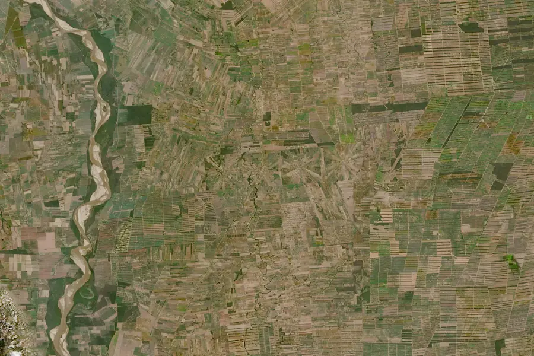

# AGRI-ORBIT · Decide what to plant next



**AGRI-ORBIT** is a decision-support web tool that compares **crop rotations** for Latin American farms using **NASA data** (climate, rainfall, soil moisture, vegetation and water storage) together with each farmer's conditions and priorities.

A **Team Brujos** project for the NASA Space Apps Challenge, *“Changing Course: adapting farms with NASA data”*.

> AGRI-ORBIT provides the data and runs the agronomic calculations. AGRI-AI interprets and explains them. Neither replaces the extension agent: always validate in the field.

---

## What it does

1. **Explore your farm.** Pick a region (44 reference regions in 20 Latin American countries, plus one in the US) or a point on the globe. Then set soil texture, organic matter, pH, slope, irrigation and your current rotation.
2. **Compare rotations.** The engine scores more than a thousand combinations of 18 crops and cover crops. It ranks them by your priorities: profit, soil health, water saving, stability and forage.
3. **Understand the result.** For each option it shows:
   - water deficit (estimated, irrigation applied and remaining);
   - bare-soil months, stability and nitrogen;
   - benefits and trade-offs;
   - which data still needs validation;
   - a Monte Carlo simulation over 1,000 climate years.
4. **See your area from space.** An interactive globe with NASA GIBS layers: true color, rainfall, soil moisture, vegetation and total water storage.

### Demo case: Dry Corridor of Chiquimula, Guatemala
The **“Try the Chiquimula case”** button loads a rain-fed farm with a first-season + second-season maize rotation (editable). It compares that rotation with two alternatives under the same climate scenario:
- **Maize + grain legumes**
- **Maize + green manure + sorghum**

You can switch between **“Save water”** and **“Protect the soil”** to see how the scores change.

---

## Data sources

| Use | Source | Note |
|---|---|---|
| Engine climate | **NASA POWER** (Agroclimatology API) | Temperature, rainfall, root-zone moisture and radiation. Monthly climatology and daily series, ~0.5° grid |
| Sowing-window rainfall | **GPM IMERG** via NASA POWER Daily | Online only. A missing day is not counted as zero |
| Globe and map layers | **NASA GIBS** | VIIRS, MODIS NDVI, SMAP L4, IMERG, SRTM and GRACE-FO. **Visualization only**: they do not feed the engine |
| Groundwater context | **GRACE / GRACE-FO** | Regional anomaly of total water storage, not a plot-level value |
| Soil and slope | Farmer input | Suggested national references: MAGA/ICTA and INSIVUMEH |
| Offline | `snap/` | Local copy of NASA POWER and GIBS, country boundaries and D3 |

Every figure carries a provenance tag: **Live**, **Snapshot**, **Reference**, **Farmer**, **Model** or **GIBS**. The 0–100 indices are relative model estimates, not yield forecasts.

---

## AGRI-AI · farming assistant

It is the floating button at the bottom right. It answers in Spanish and English about your land, the NASA data and the rotations, using the app's current state as context. It does not invent data and says when information is missing.

It works with any provider compatible with OpenAI Chat Completions (OpenAI, Google Gemini, Groq, OpenRouter, Ollama…). The key lives **only** on the server (`server/.env`), never in public JavaScript. If the backend is not running, the app keeps working and the chat says so.

---

## How to run it

No build step: plain HTML, CSS and JavaScript (MVC pattern).

**Web only** (no chat):
```bash
cd agri-orbit-web-mvc
python3 -m http.server 8080      # or Live Server in VS Code
# open http://localhost:8080
```

**With AGRI-AI** (Node ≥ 18, no dependencies):
```bash
cd agri-orbit-web-mvc/server
cp .env.example .env             # set OPENAI_API_KEY (and OPENAI_MODEL / OPENAI_BASE_URL)
node index.js                    # http://localhost:8787 serves the web + /api/agri-ai
```
If you use Live Server (`127.0.0.1:5501`), the page automatically uses the backend on `:8787`.

Example with Google Gemini (free key at https://aistudio.google.com/apikey):
```env
OPENAI_API_KEY=your_key
OPENAI_MODEL=gemini-flash-lite-latest
OPENAI_BASE_URL=https://generativelanguage.googleapis.com/v1beta/openai
```

**Tests:**
```bash
cd agri-orbit-web-mvc
node tests/model.test.js && node tests/render.smoke.js
node tests/agri-ai.test.js && node tests/agri-ai.server.test.js
```

---

## Structure

```
agri-orbit-web-mvc/
  index.html, css/style.css     interface
  js/models/                    data, agronomic engine, NASA, globe, AGRI-AI
  js/views/                     render* functions for each section
  js/controllers/               events and startup
  js/vendor/d3.min.js           local D3 (the globe works without internet)
  snap/                         NASA snapshot (POWER, GIBS), country boundaries, cover image
  server/                       Node backend: AGRI-AI (/api/agri-ai)
  tests/                        Node tests
```

Detailed technical documentation is in [`agri-orbit-web-mvc/README.md`](agri-orbit-web-mvc/README.md).

---

## Limitations

- It is a rules-and-scores model, not a physiological simulator like DSSAT or AquaCrop. Crop coefficients are simplified and generic.
- NASA POWER describes cells of about 50 km, so your plot may differ. Texture, pH and organic matter are the values you enter.
- Future scenarios are illustrative; NEX-GDDP-CMIP6 projections are not integrated yet.
- It does not include prices or costs: check the market before switching crops.
- It is a demonstration prototype. Discuss the result with local extension agents (e.g., ICTA or MAGA in Guatemala).

NASA does not endorse any non-U.S. Government entity. Country boundaries: Natural Earth (world-atlas).
